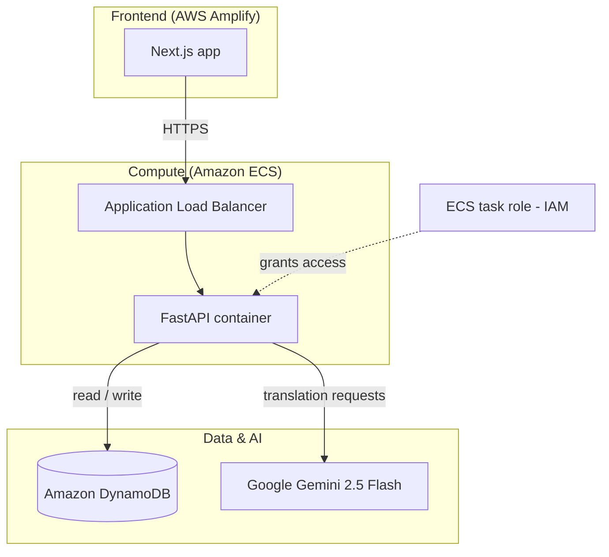

# Yorubot – AI Yorùbá Translator & Dictionary

An English-to-Yorùbá translator that returns **correctly tone-marked Yorùbá**, a tone breakdown for each word, and a plain-English interpretation. It is live at [yorubot.com](https://yorubot.com).

Most machine translators drop or misplace Yorùbá tone marks, and that changes the meaning (*ọkọ* can mean husband, hoe or vehicle depending on tone). Yorubot asks the AI model for structured, toned output. It then stores corrections, so common words are served from its own dictionary instead of being re-generated each time.

> This is a showcase copy of the code. The production repositories are private; this version has no secrets and no payment logic.

## Architecture

**How a request flows**

1. The user types English text in the Next.js frontend and clicks **Translate**.
2. The request goes over HTTPS to an Application Load Balancer, which routes it to the FastAPI container running on Amazon ECS.
3. The backend first checks its dictionary cache. If the phrase has been translated or corrected before, it returns that version straight away.
4. If the phrase isn't cached, the backend calls Google Gemini 2.5 Flash with a prompt that requires strict JSON: the toned Yorùbá text, the tone of each word, and an English interpretation.
5. The result goes back to the frontend, which displays each word with its tone label. Users can edit a word, and that correction is saved back to the dictionary.

## Tech stack

| Layer | Technology |
| --- | --- |
| Frontend | Next.js (TypeScript), hosted on AWS Amplify |
| API | Python, FastAPI, Uvicorn |
| Container | Docker, Amazon ECS behind an Application Load Balancer |
| Database | Amazon DynamoDB (via boto3), local SQLite cache |
| AI | Google Gemini 2.5 Flash (`google-genai`) |
| Auth | Clerk (session tokens verified server-side) |
| Monitoring | UptimeRobot health check on `HEAD /` |

## Cloud and security decisions

- **No credentials in code.** API keys are read from environment variables. The ECS task uses an **IAM task role** to reach DynamoDB, so there are no AWS access keys in the container at all.
- **`.dockerignore`** keeps `.env` files and the virtual environment out of the Docker image.
- **Server-side checks.** User identity comes from a Clerk session token that the backend verifies itself, rather than trusting a user ID sent by the browser.
- **Health check route** (`HEAD /`), so the load balancer and uptime monitor can confirm the container is alive.

## API endpoints

| Method | Path | Purpose |
| --- | --- | --- |
| `GET` / `HEAD` | `/` | Health check |
| `POST` | `/api/dev-translate` | Translate English text to tone-marked Yorùbá |
| `POST` | `/api/dictionary/save` | Save a user's correction to the dictionary |

## Screenshots

_Add 2–3 screenshots here: the translate screen, a tone breakdown, and the edit view._

## What I learned

- Deploying a containerised Python API to **Amazon ECS** behind a load balancer, and hosting a frontend on **AWS Amplify**
- Using **IAM roles** instead of stored access keys
- Prompting an LLM for reliable **structured JSON** output
- Moving from an early Render deployment to AWS as the project grew

## Roadmap

- Monthly review log of translations for a Yorùbá linguist to check tone accuracy
- Redesigned UI with a side-by-side English / Yorùbá layout

## Author

**Gideon** – [github.com/ogidiomo](https://github.com/ogidiomo)
